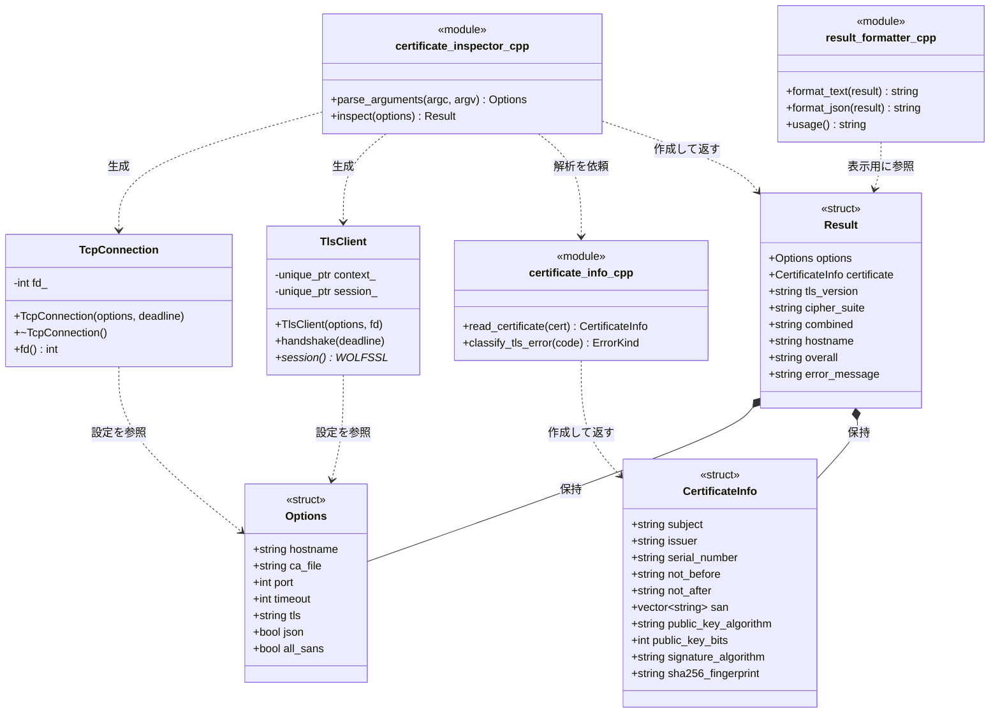

<!-- SPDX-License-Identifier: GPL-3.0-only -->

# Class Diagram

This diagram shows the main classes, data structures, and function groups in the current implementation. Some members, error types, and internal helpers are omitted for readability. Nodes marked `module` represent free functions grouped by source file, not C++ classes. All application types and functions shown belong to the `inspector` namespace.

`+` means public, `-` means private, `*--` indicates composition (ownership), and `..>` indicates a dependency. `TlsClient` receives the socket descriptor as an integer; it does not own a `TcpConnection`. The `inspect()` function manages both objects and their lifetimes.

## Viewing the Diagram

- **GitHub:** after publishing the repository, open this Markdown file in GitHub's rendered view. GitHub renders the fenced `mermaid` block as a diagram. See [GitHub's diagram documentation](https://docs.github.com/en/get-started/writing-on-github/working-with-advanced-formatting/creating-diagrams).
- **Browser:** open [Mermaid Live Editor](https://mermaid.live/) and paste the contents of the code block, from `classDiagram` through its final relationship. Omit the opening and closing Markdown fences. The editor previews the diagram and supports image export.
- **Editor:** use a Markdown preview with Mermaid support to open this file locally. A plain text editor displays the diagram source instead of rendering it.

The diagram is maintained manually. Update it when changing the implementation's types or relationships.
