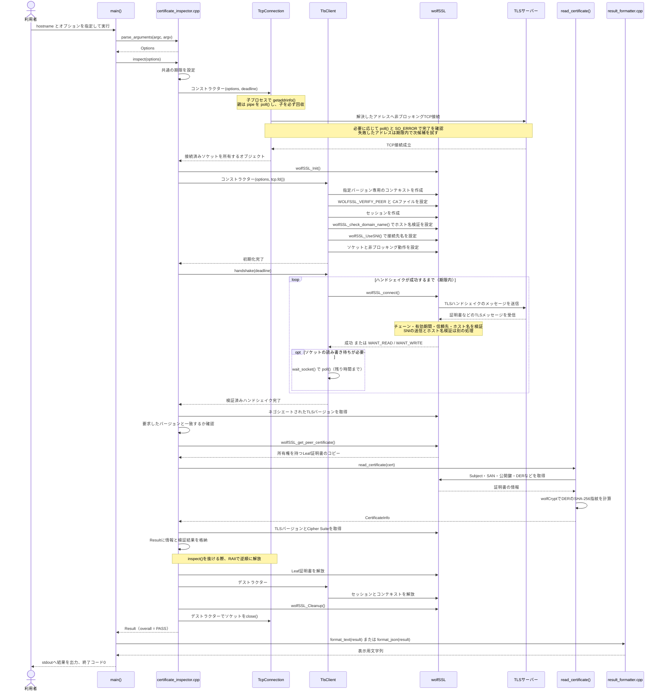
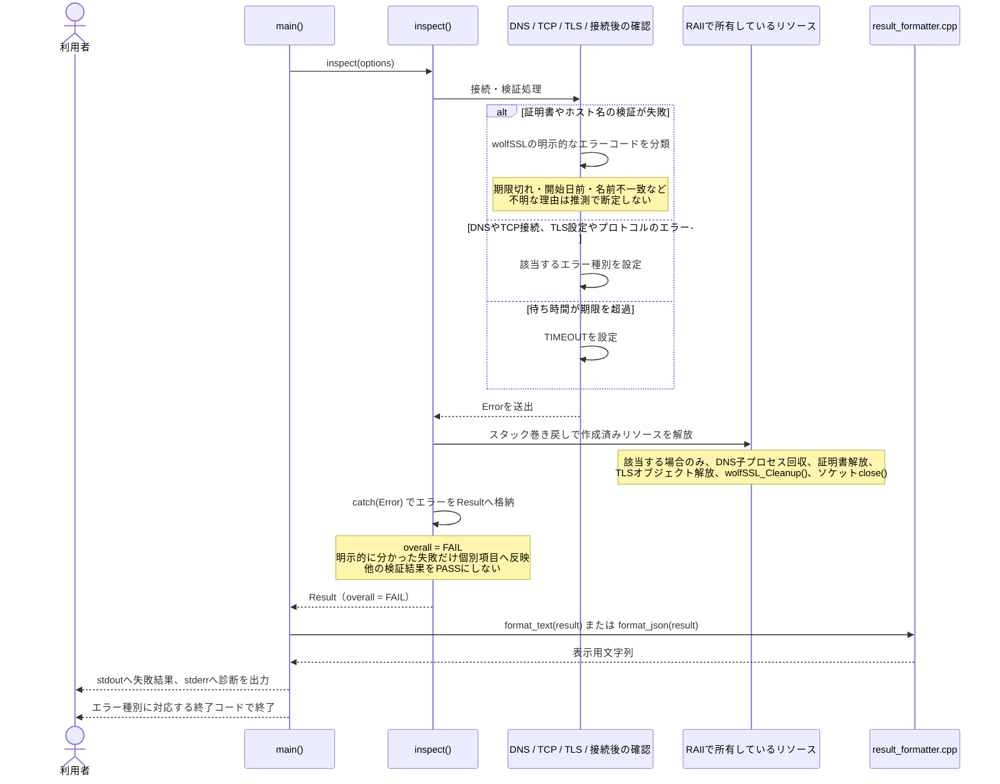

<!-- SPDX-License-Identifier: GPL-3.0-only -->

# Sequence Diagrams

These diagrams describe the current CLI implementation. Participants represent objects or groups of free functions; they are not all C++ classes. The TLS message exchange is summarized rather than showing every TLS protocol message. Diagram labels are in Japanese to match the class diagram.

## Successful Inspection

This path assumes valid arguments without `--help`, successful certificate and hostname verification, and successful peer-certificate retrieval. `inspect()` uses one monotonic deadline for DNS, TCP and the handshake.

The constructor's socket descriptor is borrowed by `TlsClient`; `TcpConnection` owns and closes the socket. The `wait_socket()` call is a free helper function, not a `TlsClient` member. DNS resolution occurs before initializing wolfSSL. Only combined verification and hostname success are reported as PASS; individual chain/date/trust success results are not invented. Limiting SAN text output does not limit certificate verification.

## Failed Inspection

This path shows an `inspector::Error` thrown during DNS resolution, TCP connection, TLS setup, the handshake, or a post-handshake check. A constructor that fails releases already-created resources; only successfully constructed objects are destroyed. Not all failures reach the TLS stage.

Argument errors are caught directly in `main()` and return exit code 2, with stderr diagnostics and a JSON failure report only when `--json` is present. `--help` returns exit code 0 without connecting. Other `std::exception` failures that escape inspection are caught by `main()` and return exit code 6; their JSON report is likewise emitted only in JSON mode.

Inspection failures return code 3 for classified certificate/hostname failures, 4 for DNS/TCP/TLS/configuration failures, 5 for timeouts, and 6 for other application failures. The failure report never treats an unsuccessful inspection as a successful TLS session.

## Viewing the Diagrams

Open this Markdown file in a Mermaid-compatible preview or in GitHub's rendered view after publishing. For [Mermaid Live Editor](https://mermaid.live/), copy one `sequenceDiagram` block at a time without the Markdown fences. Each block renders as a separate diagram. See the [class diagram](class-diagram.md#viewing-the-diagram) for additional viewing instructions.

These diagrams are maintained manually. Update them when changing the implementation's control flow or resource ownership.
